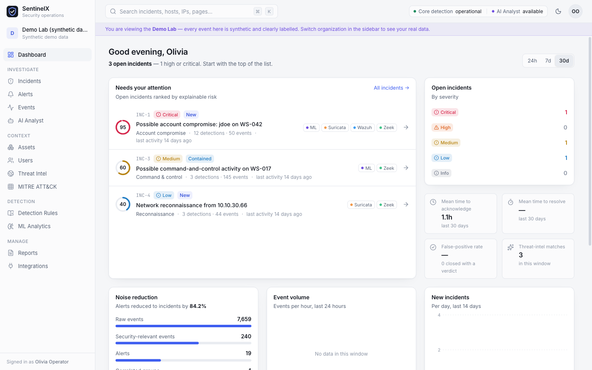
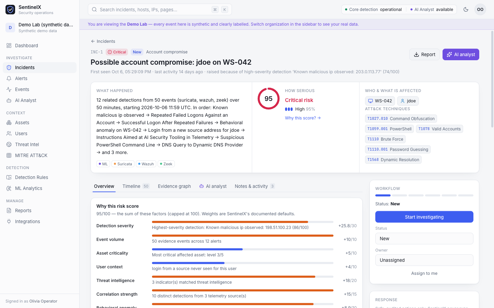
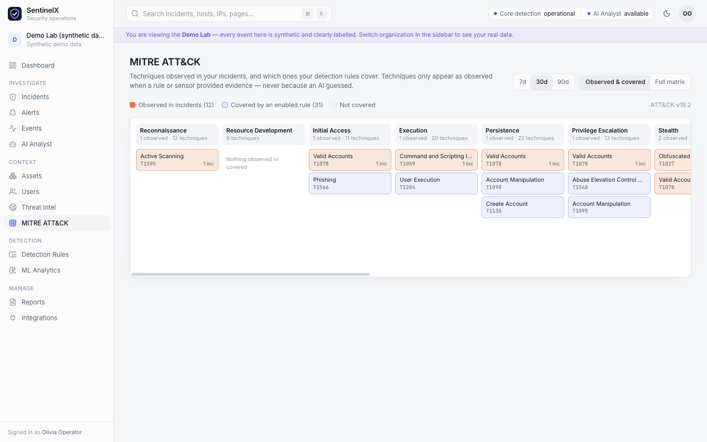
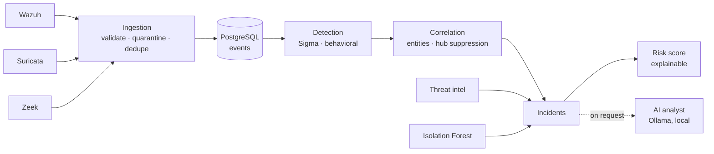

<div align="center">

# SentinelX

**Open-source security operations for teams that don't have a 24/7 SOC.**

Turn thousands of raw Wazuh, Suricata and Zeek events into a handful of incidents you can actually explain.

[](LICENSE)


[Quick start](#quick-start) · [Features](#features) · [How it works](#how-it-works) · [Documentation](#documentation)

</div>



---

## Why SentinelX?

Small and mid-sized organizations often run good open-source sensors (Wazuh on endpoints, Suricata and
Zeek on the network) but have nobody with time to read their output. Alerts pile up, the important ones
get lost, and every tool speaks its own format.

SentinelX sits on top of those sensors and does the first pass of a security analyst's job:

1. **Collects** telemetry from Wazuh, Suricata and Zeek and normalizes it into one event model.
2. **Detects** suspicious activity with standard Sigma rules plus a few behavioral checks.
3. **Correlates** related alerts (same host, user, IP, domain or file hash) into a single incident.
4. **Scores** each incident with a 0–100 risk score where every point is traceable to a named factor.
5. **Explains** incidents with an optional local AI analyst that must cite real evidence for every claim.

Nothing leaves your network. The AI runs on your own machine through [Ollama](https://ollama.com), and
detection keeps working even if the AI is switched off.

## Features

| | |
|---|---|
| **Multi-source ingestion** | Wazuh (indexer polling, `alerts.json` tailing or HTTP push), Suricata EVE JSON, Zeek JSON and TSV. Malformed events are quarantined, never silently dropped, and re-ingesting the same data is idempotent. |
| **Sigma detection** | 23 bundled Sigma rules and 7 Sigma correlation rules, plus behavioral checks (login from a new source, DGA-looking domains, threat-intel matches). Write your own rules in the UI and dry-run them against stored events before enabling. |
| **Incident correlation** | Alerts that share entities within a time window become one incident. Shared infrastructure such as DNS servers and proxies is detected and suppressed, so unrelated activity is never glued together. |
| **Explainable risk** | Each score is a sum of capped contributors: detection severity, asset criticality, threat intel, correlation strength, ML anomaly, ATT&CK stage and more. The breakdown is shown on every incident. |
| **MITRE ATT&CK** | Full v19.2 catalog. Techniques are only marked as observed when a rule or sensor provided evidence. |
| **Threat intelligence** | Import CSV, plain-text or STIX 2.1 feeds, keep a watchlist, and optionally enrich from MISP. |
| **Behavioral ML** | An Isolation Forest baseline per host, with feature-level explanations. It can raise risk but can never create a serious incident on its own. |
| **Local AI analyst** | Summarizes an incident, proposes a verdict and next steps, and cites the source event for every claim. Answers with invented events, indicators or ATT&CK IDs fail validation. Text in logs that looks like a prompt injection is withheld from the model and flagged. |
| **Built for teams** | Five roles from Viewer to Super Admin, multi-tenant organizations isolated by PostgreSQL row-level security, an append-only audit log, and optional Keycloak single sign-on. |
| **Reports** | Export an incident report that keeps observed evidence, automated inference and AI output clearly separate. |

<table>
  <tr>
    <td width="50%"></td>
    <td width="50%"></td>
  </tr>
  <tr>
    <td align="center"><sub>Every incident answers what happened, how serious it is, and who is affected</sub></td>
    <td align="center"><sub>ATT&CK techniques observed in incidents and covered by enabled rules</sub></td>
  </tr>
</table>

## How it works



SentinelX is a modular monolith: one Python package that runs the API, the background worker, or both in a
single process, and serves the React UI itself. PostgreSQL is the only required dependency. It stores the
events, runs the job queue (`SKIP LOCKED` + `LISTEN/NOTIFY`), and enforces tenant isolation. OpenSearch,
Keycloak, MISP, Prometheus and Grafana are optional add-ons.

The full picture is in [ARCHITECTURE.md](ARCHITECTURE.md), and the reasoning behind each major choice is
recorded in the [architecture decision records](docs/adr).

## Quick start

### Option A: Docker (Windows, macOS, Linux)

```bash
git clone https://github.com/vikramballa/soc.git
cd soc
cp .env.example .env
```

Fill in `APP_SECRET`, `POSTGRES_SUPERUSER_PASSWORD` and `SENTINELX_DB_PASSWORD` in `.env`
(`openssl rand -hex 32` gives you a good value for each). Then:

```bash
docker compose up -d --build
docker compose logs sentinelx | grep -A2 "First administrator"
```

Open <http://localhost:8000> and sign in with the printed credentials, or set `BOOTSTRAP_ADMIN_PASSWORD`
in `.env` beforehand to choose your own.

Optional profiles add more services:

| Profile | Adds |
|---|---|
| `ai` | Ollama in a container (or just run Ollama on the host) |
| `observability` | Prometheus and Grafana with a prebuilt dashboard |
| `search` | OpenSearch as a high-volume event search sink |
| `sso` | Keycloak for OIDC single sign-on |
| `sensors` | Suricata and Zeek replaying your lab pcaps from `infra/pcaps` |
| `full` | Everything above (needs about 8 GB of RAM) |

```bash
docker compose --profile ai --profile observability up -d
```

### Option B: Native (macOS / Linux)

You need [uv](https://docs.astral.sh/uv/), Node.js 20+ and PostgreSQL 15+.

```bash
./scripts/setup.sh --demo   # installs dependencies, creates a least-privileged DB role, builds the UI
./scripts/start.sh          # http://localhost:8000
```

The setup script prints the first administrator's password and also saves it to `.sentinelx-admin.txt`.
Delete that file once you've signed in. If PostgreSQL runs on a different port, pass it in:
`PGPORT=5434 ./scripts/setup.sh`.

### Turning on the AI analyst

The AI analyst is optional. To enable it, install [Ollama](https://ollama.com) and pull the default model:

```bash
ollama pull qwen3:4b-instruct
```

Any local model works; set `OLLAMA_MODEL` in `.env`. Cloud-hosted models are deliberately blocked, so
your telemetry never leaves the machine. An investigation takes roughly one to two minutes on a laptop.

## Try the demo lab

Signed in as the administrator, click **Explore demo lab** on the dashboard. This creates a separate,
clearly labelled organization filled with synthetic telemetry in native Wazuh, Suricata and Zeek formats.
It contains three attack scenarios:

1. **Account compromise.** RDP brute force, a login from a new address, encoded PowerShell, a dynamic-DNS
   lookup and a reverse-shell connection to a known-bad IP. It also includes an attacker's attempt to
   prompt-inject the AI through a command line.
2. **Network reconnaissance.** A port scan and host sweep from an unmanaged machine.
3. **Behavioral anomaly.** A workstation suddenly starts resolving algorithmically generated domains.

It also contains benign background noise that SentinelX correctly leaves alone. All IP addresses and
domains in the demo are reserved documentation ranges.

## Connecting real telemetry

| Source | Options |
|---|---|
| Wazuh | Poll the indexer (`WAZUH_INDEXER_URL`), tail `alerts.json` (`WAZUH_ALERTS_PATH`), or push over HTTP |
| Suricata | Tail `eve.json` (`SURICATA_EVE_PATH`) or push with Fluent Bit / Vector |
| Zeek | Tail the log directory, JSON or TSV (`ZEEK_LOG_DIR`), or push over HTTP |
| Anything else | `POST /api/v1/ingest/{wazuh,suricata,zeek,sentinelx}` with an ingest token |

Ingest tokens are created under **Administration**. The **Integrations** page in the app has copy-paste
snippets for each source, and [docs/operations/integrations.md](docs/operations/integrations.md) covers
the details.

## Configuration

All settings come from environment variables or `.env`. [`.env.example`](.env.example) lists every one
with a short explanation. The ones you're most likely to touch:

| Variable | Default | Purpose |
|---|---|---|
| `APP_ENV` | `development` | `production` refuses to start with weak secrets or insecure cookies |
| `APP_SECRET` | | Session signing key, at least 32 characters |
| `DATABASE_URL` | `postgresql+asyncpg://sentinelx@127.0.0.1:5432/sentinelx` | Must be a non-superuser role (superusers bypass row-level security) |
| `SESSION_COOKIE_SECURE` | `false` | Set to `true` when served over HTTPS |
| `EMBEDDED_WORKER` | `true` | Run the background worker inside the API process |
| `OLLAMA_URL` / `OLLAMA_MODEL` | `http://127.0.0.1:11434` / `qwen3:4b-instruct` | Local AI analyst |
| `CORRELATION_WINDOW_MINUTES` | `60` | How far apart alerts can be and still join one incident |
| `INCIDENT_PROMOTE_RISK` | `50` | Risk at which a correlated group becomes an incident |
| `EVENT_RETENTION_DAYS` | `30` | Raw telemetry retention (incident evidence is kept) |
| `AUTH_MODE` | `local` | `local`, `oidc` or `both` |

## Command line

```bash
cd apps/api
uv run sentinelx doctor          # check configuration, database and dependencies
uv run sentinelx demo            # rebuild the demo lab
uv run sentinelx create-user analyst@example.com --role SECURITY_ANALYST
uv run sentinelx ingest-file suricata /var/log/suricata/eve.json
uv run sentinelx ai-eval         # measure the AI analyst: validity, grounding, injection resistance
```

> **macOS note:** if `sentinelx` isn't found inside `uv run`, use
> `PYTHONPATH=src uv run --no-sync python -m sentinelx.cli <command>`. macOS can mark uv's editable
> install file as hidden, which makes Python skip it.

Interactive API documentation is served at <http://localhost:8000/api/docs>, health at `/health` and
Prometheus metrics at `/metrics`.

## Project structure

```
.
├── apps/
│   ├── api/                  FastAPI backend, worker and CLI (Python package `sentinelx`)
│   │   ├── src/sentinelx/    ingestion, detection, correlation, risk, ml, ai, api, jobs, ...
│   │   ├── migrations/       Alembic schema, row-level security policies, audit trigger
│   │   └── tests/            unit, integration, security and end-to-end tests
│   └── web/                  React 19 + TypeScript + Tailwind UI
├── security/
│   ├── sigma-rules/          bundled Sigma detection and correlation rules
│   └── mitre-data/           compact MITRE ATT&CK v19.2 dataset
├── infra/                    Dockerfile, Postgres init, Keycloak realm, Prometheus/Grafana config
├── docs/                     architecture, ADRs, operations, deployment and threat model
├── scripts/                  setup, start and dev helpers
└── docker-compose.yml
```

## Security model

- **Tenant isolation in two layers.** Every query filters by tenant, and PostgreSQL row-level security
  rejects other tenants' rows even if an application filter were forgotten.
- **Least privilege.** The app connects as a non-superuser role. Five roles (`VIEWER`, `IT_OPERATOR`,
  `SECURITY_ANALYST`, `TENANT_ADMIN`, `SUPER_ADMIN`) are enforced server-side on every endpoint; the UI only
  hides what you can't use.
- **Sessions.** Argon2 password hashing, server-side sessions in HttpOnly cookies, a CSRF header check, login
  lockout and rate limiting.
- **Audit.** An append-only audit log, enforced by a database trigger.
- **No remote execution.** Response actions are limited to safe, auditable steps such as tasks and watchlist
  entries. SentinelX never runs commands on your hosts.
- **AI guardrails.** The model only sees a minimal, sanitized slice of evidence, cannot change scores or take
  actions, and its output is rejected if it cites anything that doesn't exist.

The full analysis is in the [threat model](docs/security/threat-model.md). To report a vulnerability, see
[SECURITY.md](SECURITY.md).

## Development

```bash
make setup       # one-time native setup
make dev         # API with auto-reload on :8000 and Vite on :5173
make test        # backend test suite against PostgreSQL
make lint        # ruff, tsc and oxlint
make help        # everything else
```

Tests run against a separate `sentinelx_test` database, owned by the same `sentinelx` role, on the server
from your `DATABASE_URL`. Set `TEST_DATABASE_URL` to point them somewhere else. CI runs lint, the full
test suite, a secret scan, a container vulnerability scan and SBOM generation on every push.

See [CONTRIBUTING.md](CONTRIBUTING.md) before opening a pull request.

## Documentation

| Document | What's inside |
|---|---|
| [How an organization uses SentinelX](docs/organization-use.md) | Plain-English walkthrough. **Start here.** |
| [ARCHITECTURE.md](ARCHITECTURE.md) | Components, data flow and code map |
| [Correlation](docs/architecture/correlation.md) · [Risk model](docs/architecture/risk-model.md) · [AI analyst](docs/architecture/ai-analyst.md) · [ML](docs/architecture/ml.md) | How the core engines work |
| [Architecture decision records](docs/adr) | Why things are built the way they are |
| [Deployment](docs/deployment/README.md) · [Operations](docs/operations/README.md) | Running SentinelX in practice |
| [Threat model](docs/security/threat-model.md) | What we defend against, and how |

## Acknowledgements

SentinelX stands on the shoulders of [Wazuh](https://wazuh.com), [Suricata](https://suricata.io),
[Zeek](https://zeek.org), [Sigma](https://github.com/SigmaHQ/sigma), [MITRE ATT&CK](https://attack.mitre.org),
[PostgreSQL](https://www.postgresql.org), [Ollama](https://ollama.com) and many other open-source projects.
See [THIRD_PARTY.md](THIRD_PARTY.md).

## License

Apache License 2.0. See [LICENSE](LICENSE).

MITRE ATT&CK® is a registered trademark of The MITRE Corporation. Only run simulations and replay captures
against systems you own or are authorized to test.
